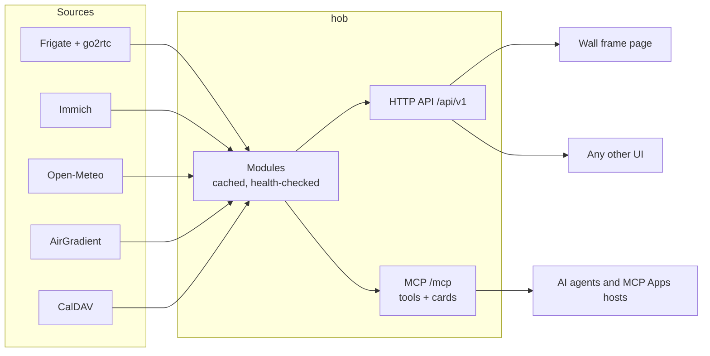

# hob

**A small, fast home backend in Rust.** One HTTP API and one MCP server for
your cameras, photos, weather, indoor air and calendar, with thin UIs on top:
a wall-frame page, MCP Apps cards for AI chat hosts, or anything you build.

> A hob is the shelf beside the hearth, and in folklore the helpful spirit of
> a house. This project is a home backend; it is unrelated to other tools
> that share the name.

## Why

Home Assistant does everything, and a house pays for it: a large Python
service, a database, thousands of integrations, and a UI you have to live
inside. Many houses use a handful of those integrations and would rather
have their own screens.

hob takes the other end. It reads the few systems a house actually runs,
keeps them behind one small, stable API, and leaves every screen to be a
thin client: a photo frame on the wall, a dashboard, a phone, or an AI agent
over [MCP](https://modelcontextprotocol.io). The camera engine stays
[Frigate](https://frigate.video) and the photo library stays
[Immich](https://immich.app); hob is the layer between them and everything
that wants to show or control them.

- **One binary**, a few megabytes, no database, no runtime to install. Run
  it from Nix, Docker, systemd or `cargo`.
- **Nothing house-specific in the code.** Every address, camera, album,
  place and secret comes from configuration.
- **Agent-ready.** Every function is an MCP tool, and two of them come with
  interactive cards for hosts that support MCP Apps.

## Features

| Module | Source | What you get |
|---|---|---|
| Cameras | Frigate + go2rtc | Stills, live view (fragmented MP4), pan and tilt, the timeline of what Frigate saw with each event's thumbnail and clip |
| Photos | Immich | One album, listed and served at screen size (fitted once, cached on disk); the API key never leaves the server |
| Weather | Open-Meteo | Now, the next day by the hour, the next week by the day; no key needed |
| Air | AirGradient | CO₂, temperature, humidity, particulates, VOC and NOx indexes from the monitor's local API |
| Calendar | CalDAV | Every calendar on one or more accounts, read only, recurring events expanded |

Leave out any module your house does not have; its routes answer 404 and
its tools are not listed.

## Architecture



**Modules.** Each domain is one module with the same contract, after Home
Assistant's update coordinator: it fetches from its upstream at most once per
freshness window, keeps the last good answer through an outage, and reports
its health. Unlike Home Assistant, a fetch happens only when a client asks,
so a house with nothing open costs its upstreams nothing.

**HTTP API.** Versioned under `/api/v1`. Screens read the house only
through it, and hold no logic of their own.

**MCP.** Streamable HTTP at `/mcp`, stateless JSON-RPC. Two tools carry
[MCP Apps](https://github.com/modelcontextprotocol/ext-apps) cards (the
`io.modelcontextprotocol/ui` extension): the cameras with live views and the
timeline, and an overview of the house. The endpoint answers loopback only
and refuses browsers, so put it behind a proxy on the same host to reach it
from elsewhere.

**The frame page.** Served at `/`. A full-screen slideshow of the album with
the time, the week's calendar, the forecast and the air, plus a cameras view
with pan and tilt. Built for the WebView of a rooted photo frame: swipe
between photos, pick how long each stays, and the page reloads itself when
the server is redeployed.

**I/O** blocks throughout, a thread per connection. Every upstream client
blocks anyway, a house has a handful of clients, and there is no async
runtime to carry.

## Quick start

### NixOS

```nix
{
  inputs.hob.url = "github:dycli/hob";

  outputs = { nixpkgs, hob, ... }: {
    nixosConfigurations.house = nixpkgs.lib.nixosSystem {
      modules = [
        hob.nixosModules.default
        {
          services.hob = {
            enable = true;
            address = "0.0.0.0";          # listen for screens on the LAN
            publicUrl = "https://hob.example.net";
            photos = {
              immichUrl = "http://127.0.0.1:2283";
              apiKeyFile = "/run/secrets/immich-key";
              album = "Wall";
            };
            weather = { latitude = 51.48; longitude = -0.01; };
            air.address = "192.0.2.10";
            calendar.accountsFile = "/run/secrets/caldav.json";
            cameras = {
              list = [
                { id = "front-door"; name = "Front door"; turns = false; }
                { id = "garden"; name = "Garden"; turns = true; }
              ];
              go2rtcUrl = "http://127.0.0.1:1984";
              frigateUrl = "http://127.0.0.1:5000";
            };
          };
        }
      ];
    };
  };
}
```

Secrets are read through systemd credentials and never reach the Nix store.
Which networks may reach the port, and any TLS proxy in front, are the
host's to set.

### Docker

```sh
docker run -d --name hob -p 8970:8970 \
  -e HOB_TZ=Europe/London -e HOB_WEATHER=51.48,-0.01 \
  -v hob-cache:/var/cache/hob \
  ghcr.io/dycli/hob:latest
```

The image is a static binary on a distroless base (about 10 MB), running as
a non-root user. [`compose.yaml`](compose.yaml) shows a full setup with
every module, secrets mounted read-only and the photo cache in a volume.
MCP answers loopback only, so to reach it from the host, run the container
with host networking (`network_mode: host`).

### systemd

With a release binary in `/usr/local/bin/hob`, settings in
`/etc/hob/hob.env` (`HOB_TZ=…`, one per line) and secrets in `/etc/hob/`:

```ini
# /etc/systemd/system/hob.service
[Unit]
Description=hob, the house's backend
Wants=network-online.target
After=network-online.target

[Service]
ExecStart=/usr/local/bin/hob
EnvironmentFile=/etc/hob/hob.env
Environment=HOB_LISTEN=0.0.0.0:8970
# Secrets reach the service as credentials, readable by it alone. Drop
# the lines for any module you do not run.
LoadCredential=immich-key:/etc/hob/immich-key
LoadCredential=caldav:/etc/hob/caldav.json
Environment=HOB_IMMICH_KEY_FILE=%d/immich-key HOB_CALDAV_FILE=%d/caldav
# Fitted photos, kept across restarts in /var/cache/hob.
CacheDirectory=hob
DynamicUser=yes
ProtectSystem=strict
ProtectHome=yes
PrivateTmp=yes
NoNewPrivileges=yes
Restart=on-failure

[Install]
WantedBy=multi-user.target
```

Then `systemctl enable --now hob`.

### Cargo

```sh
cargo build --release
HOB_LISTEN=127.0.0.1:8970 HOB_TZ=Europe/London \
HOB_WEATHER=51.48,-0.01 \
./target/release/hob
```

Releases carry static binaries for Linux x86-64 and aarch64 (a Raspberry
Pi runs it), and the image for both, built by
[the release workflow](.github/workflows/release.yml) on each version tag.

## Configuration

The program reads its environment; the NixOS module sets it for you.

| Variable | NixOS option | Meaning |
|---|---|---|
| `HOB_LISTEN` | `address`, `port` | Address to bind, e.g. `0.0.0.0:8970` |
| `HOB_TZ` | `timeZone` | The house's time zone, for days and times |
| `HOB_PUBLIC` | `publicUrl` | Where MCP hosts reach hob; the cards load pictures from it |
| `HOB_IMMICH`, `HOB_IMMICH_KEY_FILE`, `HOB_ALBUM` | `photos.*` | Immich's URL, a file holding an API key (album.read, asset.read, asset.view), the album |
| `CACHE_DIRECTORY` | (set by systemd) | Where fitted photos are kept |
| `HOB_WEATHER` | `weather.latitude`, `weather.longitude` | `latitude,longitude` |
| `HOB_AIR` | `air.address` | The AirGradient monitor's address |
| `HOB_CALDAV_FILE` | `calendar.accountsFile` | `[{"name","url","username","password"}]` |
| `HOB_CAMERAS`, `HOB_GO2RTC`, `HOB_FRIGATE` | `cameras.*` | `[{"id","name","turns"}]` by Frigate name, and both APIs |

## API

| Route | Answer |
|---|---|
| `GET /api/v1/health` | `{boot, modules: [{module, ok, last_good, error}]}` |
| `GET /api/v1/photos` | `{photos: [id]}` |
| `GET /api/v1/photos/{id}` | The photo as JPEG, at most 1920×1080 either way round |
| `GET /api/v1/weather` | Now, 25 hours, 7 days (°F, mph) |
| `GET /api/v1/air` | CO₂, °F, humidity, PM, VOC and NOx indexes |
| `GET /api/v1/calendar` | `{days, events}` from today |
| `GET /api/v1/cameras` | `[{id, name, turns}]` |
| `GET /api/v1/cameras/{id}/snapshot.jpg?h=` | The latest frame |
| `GET /api/v1/cameras/{id}/live.mp4` | The live sub-stream |
| `POST /api/v1/cameras/{id}/turn/{left,right,up,down}` | A half-second move |
| `GET /api/v1/events?camera=&after=&before=&severity=&limit=` | Frigate review items, newest first |
| `GET /api/v1/events/{id}` · `/thumbnail.webp` · `/clip.mp4` | One event |

A module the house does not have answers 404; one that is down answers 502,
or its last good reading while it has one.

## MCP tools

| Tool | Card | What it does |
|---|---|---|
| `home` | Overview | The house at a glance: weather, air, today and tomorrow, camera stills, anything not answering |
| `weather` | | The forecast |
| `air` | | The air indoors |
| `calendar` | | The week ahead |
| `cameras` | Cameras | The cameras and the last day's events |
| `camera_events` | Cameras | Events by camera, time span and severity |
| `camera_snapshot` | | One camera's latest frame, as an image |
| `camera_turn` | | Pan or tilt a camera that turns |

## Roadmap

- **Tapo** device controls.
- **Z-Wave** through [Z-Wave JS](https://zwave-js.github.io): locks,
  switches, dimmers and sensors, with an entity model and a change stream.
- **Automations** over the modules' state and events.

## Development

```sh
nix build          # the package
nix flake check    # tests, clippy with warnings denied, the module evaluating
cargo test
```

## License

Licensed under either of [Apache License, Version 2.0](LICENSE-APACHE) or
[MIT license](LICENSE-MIT), at your option.
